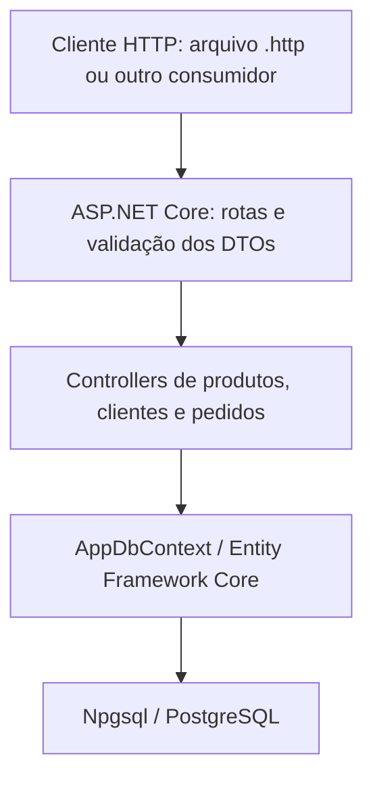

# Gestão Marmitaria

API REST para gestão de uma marmitaria, desenvolvida em **C# com ASP.NET Core, Entity Framework Core e PostgreSQL**.

O projeto busca centralizar informações que pequenos negócios frequentemente organizam em conversas, cadernos ou planilhas. A construção é incremental: a base atual oferece cadastro e manutenção de **produtos e clientes**, além de **criação e consulta de pedidos com itens**, entrega ou retirada e preservação dos preços históricos. Pagamentos e acompanhamento do andamento fazem parte das próximas etapas.

**Status:** em desenvolvimento. Os CRUDs de produtos e clientes e a criação e consulta de pedidos estão implementados. O tratamento de exclusões vinculadas com `409 Conflict`, as transições de status, a autenticação e o frontend ainda estão pendentes.

## Objetivo e contexto

O sistema é direcionado à rotina do dono e dos funcionários de uma marmitaria. A visão do produto inclui organização do cardápio, identificação dos clientes e acompanhamento dos pedidos desde o registro até a entrega ou retirada.

Além da aplicação prática, o projeto é desenvolvido para consolidar conhecimentos de backend: contratos HTTP, validação de entrada, programação assíncrona, injeção de dependência, persistência relacional e evolução do banco com migrations.

O escopo planejado contempla marmitas P/M/G, bebidas, doces e adicionais. Na implementação atual, todos são representados pelo cadastro genérico de `Produto`; ainda não há categorias ou tamanhos estruturados no modelo.

## Funcionalidades implementadas

### Produtos

- Cadastro, listagem, consulta por ID, atualização e exclusão.
- Nome obrigatório e descrição opcional.
- Validação de preço e limites de tamanho dos textos.
- Controle do campo `Ativo` na atualização.
- ID gerado pelo PostgreSQL.

### Clientes

- Cadastro, listagem, consulta por ID, atualização e exclusão.
- Nome e telefone obrigatórios; endereço opcional.
- Validação básica de formato de telefone com DDD.
- Entrada de telefone com ou sem formatação.
- Normalização do telefone para armazenar apenas dígitos, tanto no cadastro quanto na atualização.

### Pedidos

- Criação com cliente existente e produtos ativos, consultados em uma única busca.
- Consulta por ID com itens, subtotais e total.
- Entrega com endereço obrigatório e taxa fixa de R$ 5,00; retirada sem endereço e sem taxa.
- Validação de quantidade, modalidade, lista vazia, itens nulos e produtos repetidos.
- Preservação do nome e do preço unitário históricos.
- Gravação do pedido e dos itens em uma única chamada a `SaveChangesAsync()`.
- Respostas por DTO, evitando ciclos de serialização.

### Infraestrutura da API

- Persistência em PostgreSQL, mantendo os dados após reiniciar a aplicação.
- Consultas e gravações assíncronas com EF Core.
- Consultas de leitura com `AsNoTracking()`.
- Listagens ordenadas por ID.
- Validação automática dos DTOs por meio de `[ApiController]`.
- Resposta de cadastro com `201 Created`, objeto criado e cabeçalho `Location`.
- Documento OpenAPI disponível no ambiente de desenvolvimento.
- Endpoint de status da aplicação.
- Arquivo `.http` com requisições para verificação manual.

## Tecnologias e ferramentas

| Tecnologia / ferramenta | Utilização |
| --- | --- |
| C# / .NET 10 | Linguagem e plataforma do backend |
| ASP.NET Core Web API | Rotas, controllers e processamento HTTP |
| Entity Framework Core | Consultas, rastreamento de entidades e persistência |
| Npgsql | Provedor do EF Core para PostgreSQL |
| PostgreSQL | Banco de dados relacional; desenvolvimento realizado com a versão 18 |
| Data Annotations | Validação dos contratos de entrada |
| OpenAPI | Descrição dos endpoints da API |
| User Secrets | Configuração local da conexão, fora dos arquivos versionados |
| Visual Studio | Desenvolvimento, depuração e execução de requisições `.http` |
| pgAdmin | Administração e inspeção do banco |
| Git / GitHub | Versionamento do código |

Pacotes declarados no projeto:

| Pacote | Versão |
| --- | --- |
| `Microsoft.AspNetCore.OpenApi` | `10.0.12` |
| `Microsoft.EntityFrameworkCore.Design` | `10.0.13` |
| `Npgsql.EntityFrameworkCore.PostgreSQL` | `10.0.3` |

As versões acima foram registradas na inspeção anterior do `.csproj`; esta atualização de documentação não incluiu nova inspeção das dependências. O frontend planejado utilizará **React com TypeScript**, mas ainda não está presente no repositório.

## Arquitetura

A aplicação está organizada em **um único projeto de API**, com separação por responsabilidade em pastas. Os controllers recebem o `AppDbContext` por injeção de dependência e acessam o banco diretamente por meio dele.



| Componente | Responsabilidade |
| --- | --- |
| `Controllers` | Receber requisições, coordenar operações e devolver respostas HTTP |
| `Dtos` | Definir contratos de entrada e suas validações, além dos DTOs de resposta dos pedidos |
| `Models` | Representar as entidades persistidas: `Produto`, `Cliente`, `Pedido` e `ItemPedido` |
| `Data/AppDbContext.cs` | Expor os conjuntos de entidades e configurar o mapeamento das colunas |
| `Migrations` | Registrar a evolução da estrutura do banco |
| `Program.cs` | Registrar serviços, configurar o PostgreSQL e montar o pipeline HTTP |

Nas leituras, `AsNoTracking()` evita o rastreamento de objetos que não serão alterados. Nas atualizações, o contexto acompanha a entidade consultada; as atribuições são persistidas quando `SaveChangesAsync()` é executado.

`Add()` e `Remove()` registram intenções de inserção e exclusão no contexto. A gravação efetiva acontece em `SaveChangesAsync()`.

A arquitetura atual não possui camadas próprias de serviços ou repositórios, nem implementa Clean Architecture. A organização poderá evoluir conforme surgirem regras de negócio mais complexas.

## Estrutura do repositório

| Caminho | Conteúdo |
| --- | --- |
| `GestaoMarmitaria.slnx` | Solução do Visual Studio |
| `GestaoMarmitaria.Api/GestaoMarmitaria.Api.csproj` | Framework e dependências |
| `GestaoMarmitaria.Api/Controllers/ProdutosController.cs` | CRUD de produtos |
| `GestaoMarmitaria.Api/Controllers/ClientesController.cs` | CRUD de clientes |
| `GestaoMarmitaria.Api/Controllers/StatusController.cs` | Status da aplicação |
| `GestaoMarmitaria.Api/Controllers/WeatherForecastController.cs` | Endpoint de exemplo mantido do template |
| `GestaoMarmitaria.Api/Controllers/PedidosController.cs` | Criação e consulta por ID de pedidos |
| `GestaoMarmitaria.Api/Models/` | Entidades `Produto`, `Cliente`, `Pedido` e `ItemPedido` |
| `GestaoMarmitaria.Api/Enums/` | `TipoEntrega` e `StatusPedido` |
| `GestaoMarmitaria.Api/Dtos/` | DTOs de produtos e clientes; entrada e resposta de pedidos e itens |
| `GestaoMarmitaria.Api/Data/AppDbContext.cs` | Contexto e mapeamento do EF Core |
| `GestaoMarmitaria.Api/Migrations/` | Migrations de produtos, clientes, pedidos e itens, metadados e snapshot |
| `GestaoMarmitaria.Api/Properties/launchSettings.json` | Perfis e endereços de execução local |
| `GestaoMarmitaria.Api/GestaoMarmitaria.Api.http` | Exemplos de requisições e cenários manuais |
| `GestaoMarmitaria.Api/appsettings.json` | Configurações gerais e de logging |
| `GestaoMarmitaria.Api/appsettings.Development.json` | Configurações de desenvolvimento |

O arquivo `WeatherForecast.cs` também pertence ao exemplo original do template e não integra o domínio da marmitaria.

## Modelo de dados e validações

### Produto

| Campo | Tipo C# | Regra atual |
| --- | --- | --- |
| `Id` | `int` | Chave primária gerada pelo banco |
| `Nome` | `string` | Obrigatório, até 100 caracteres |
| `Descricao` | `string?` | Opcional, até 500 caracteres |
| `Preco` | `decimal` | Entrada entre `0.01` e `9999.99`; coluna `numeric(6,2)` |
| `Ativo` | `bool` | `true` no cadastro; pode ser alterado pelo PUT |

`CriarProdutoDto` recebe nome, descrição e preço. `AtualizarProdutoDto` também recebe `Ativo`. O PUT atualiza todos esses campos; envie `ativo` explicitamente, pois sua omissão no DTO atual assume `true`.

O atributo `Range` valida o preço recebido pela API. A precisão da coluna limita a representação numérica, mas não equivale a uma restrição de preço mínimo no banco.

### Cliente

| Campo | Tipo C# | Regra atual |
| --- | --- | --- |
| `Id` | `int` | Chave primária gerada pelo banco |
| `Nome` | `string` | Obrigatório, até 100 caracteres |
| `Telefone` | `string` | Obrigatório, até 20 caracteres na entrada e formato validado |
| `Endereco` | `string?` | Opcional, até 300 caracteres |

`CriarClienteDto` e `AtualizarClienteDto` recebem nome, telefone e endereço. Ao atualizar com `endereco: null`, o endereço anterior é removido.

A validação de telefone aceita DDD com ou sem parênteses, separador opcional de espaço ou hífen e número local com oito ou nove dígitos. Exemplos aceitos:

- `(21) 99999-9999`
- `21 99999-9999`
- `21999999999`
- `2133334444`

O telefone é persistido sem máscara: `(21) 99999-9999` torna-se `21999999999`. A regra verifica a estrutura; não consulta a existência do número nem uma lista de DDDs. Código internacional `+55` não é aceito pelo contrato atual.

### Pedidos e itens

Cada `Pedido` pertence a um cliente e contém uma coleção de `ItemPedido`. Cada item referencia um produto e registra seu nome e preço no momento da compra.

| Campo / regra | Comportamento |
| --- | --- |
| Cliente | Deve existir no banco |
| Itens | Pelo menos um; não aceita itens nulos ou produtos repetidos |
| Quantidade | Maior que zero |
| Produtos | Todos devem existir e estar ativos |
| `TipoEntrega` | `1` para entrega; `2` para retirada; valores fora do enum são rejeitados |
| Endereço | Obrigatório na entrega; espaços isolados são inválidos; salvo com `Trim()` |
| Retirada | Endereço recebido é descartado e persistido como `null` |
| Taxa | Definida pelo backend: R$ 5,00 na entrega; zero na retirada |
| Data e status iniciais | Data em UTC e status `Novo` (`1`) |
| Observações | Opcionais, com remoção de espaços das extremidades |
| Subtotal | Quantidade × preço unitário histórico |
| Total | Soma dos subtotais + taxa de entrega |

`CriarPedidoDto` e o DTO de entrada de cada item validam os dados recebidos. A validação condicional de endereço, duplicidade e itens nulos utiliza `IValidatableObject`. A existência de cliente e produtos e a situação ativa dos produtos são verificadas pelo controller.

O nome e o preço são copiados do produto consultado no banco, sem aceitar esses valores do cliente HTTP. Alterações posteriores no catálogo não recalculam os pedidos antigos. O endereço fica registrado no próprio pedido.

As respostas usam `PedidoRespostaDto` e `ItemPedidoRespostaDto`, sem navegações de volta para as entidades, evitando ciclos no JSON. `Subtotal` e `Total` são propriedades calculadas dos DTOs.

O banco já restringe a exclusão de clientes e produtos vinculados a pedidos/itens. O tratamento correspondente com `409 Conflict` nos controllers ainda está pendente; a restrição do banco não equivale a esse retorno HTTP implementado.

## Como executar

### 1. Pré-requisitos

- [SDK do .NET 10](https://dotnet.microsoft.com/download/dotnet/10.0).
- [PostgreSQL](https://www.postgresql.org/download/) instalado e em execução. A versão utilizada no desenvolvimento é a 18.
- Git para clonar o repositório.
- Ferramenta `dotnet-ef` da linha 10, preferencialmente alinhada ao EF Core do projeto.
- Visual Studio com suporte ao .NET 10, ou editor e terminal de sua preferência.
- pgAdmin é opcional: facilita a administração, mas não substitui o servidor PostgreSQL.

### 2. Clonar e restaurar as dependências

```bash
git clone https://github.com/Gabriel-braga-ol/gestao-marmitaria.git
cd gestao-marmitaria/GestaoMarmitaria.Api
dotnet restore
```

Os comandos seguintes devem ser executados dentro da pasta `GestaoMarmitaria.Api`, que contém o `.csproj`.

### 3. Preparar o banco

Crie um banco chamado `gestao_marmitaria_db`, utilizando o pgAdmin ou executando, conectado a um banco administrativo como `postgres`:

```sql
CREATE DATABASE gestao_marmitaria_db;
```

O projeto utiliza esse banco separado dos bancos de outros sistemas no mesmo servidor.

### 4. Configurar a conexão

O `Program.cs` lê `ConnectionStrings:DefaultConnection`. Para desenvolvimento local, configure-a com User Secrets:

```bash
dotnet user-secrets set "ConnectionStrings:DefaultConnection" "Host=localhost;Port=5432;Database=gestao_marmitaria_db;Username=postgres;Password=SUA_SENHA"
```

Substitua usuário, senha, host e porta conforme sua instalação. `SUA_SENHA` é apenas um marcador. Se a senha possuir caracteres especiais, respeite as regras de aspas do terminal e da connection string.

O projeto já declara um `UserSecretsId`, portanto não é necessário executar `dotnet user-secrets init` ao clonar esta versão. No Visual Studio, a mesma configuração pode ser editada em **Gerenciar Segredos do Usuário**:

```json
{
  "ConnectionStrings": {
    "DefaultConnection": "Host=localhost;Port=5432;Database=gestao_marmitaria_db;Username=postgres;Password=SUA_SENHA"
  }
}
```

Não versione senhas reais no repositório. User Secrets é um recurso de desenvolvimento local, não um cofre de produção; os valores não são criptografados. Em um ambiente de hospedagem, a chave equivalente pode ser fornecida por variável de ambiente: `ConnectionStrings__DefaultConnection`.

### 5. Configurar a ferramenta do EF Core

Verifique se está instalada:

```bash
dotnet ef --version
```

Se não estiver:

```bash
dotnet tool install --global dotnet-ef --version 10.0.13
```

Se já estiver instalada globalmente em outra versão:

```bash
dotnet tool update --global dotnet-ef --version 10.0.13
```

### 6. Aplicar as migrations

Defina o ambiente de desenvolvimento no terminal para que a configuração de User Secrets seja carregada. Escolha o comando correspondente ao seu shell:

**Prompt de Comando do Windows (cmd):**

```cmd
set ASPNETCORE_ENVIRONMENT=Development
```

**PowerShell:**

```powershell
$env:ASPNETCORE_ENVIRONMENT = "Development"
```

**Bash:**

```bash
export ASPNETCORE_ENVIRONMENT=Development
```

Em seguida:

```bash
dotnet ef database update
```

Esse comando aplica as migrations existentes. Não crie uma nova migration apenas para executar o projeto clonado.

Ao terminar, o banco deverá conter `Produtos`, `Clientes`, `Pedidos`, `ItensPedido` e `__EFMigrationsHistory`. As migrations não cadastram dados iniciais: crie um cliente e um produto ativo antes de testar pedidos.

### 7. Executar a API

Para executar com o perfil HTTP usado pelo arquivo `.http`:

```bash
dotnet run --launch-profile http
```

Endereço configurado: **http://localhost:5149**.

Para HTTPS:

```bash
dotnet dev-certs https --trust
dotnet run --launch-profile https
```

Endereço configurado: **https://localhost:7163**. A confiança no certificado depende do sistema operacional; o perfil HTTP permite a verificação local sem configurar confiança em HTTPS.

Os perfis de execução definem `Development`. Os endereços vêm de `Properties/launchSettings.json`; confirme também as linhas `Now listening on` no terminal. A aplicação possui middleware de redirecionamento HTTPS, cujo comportamento depende da configuração de execução.

No Visual Studio, abra `GestaoMarmitaria.slnx`, selecione a API como projeto de inicialização e execute o perfil desejado.

### 8. Conferir o funcionamento

Acesse `GET http://localhost:5149/api/status` usando o perfil HTTP. A resposta esperada é:

```json
{
  "sistema": "GestaoMarmitaria",
  "status": "online"
}
```

Esse endpoint confirma que a API responde; não realiza uma verificação da conexão com o banco. Para isso, execute também `GET /api/produtos` ou `GET /api/clientes`.

Em desenvolvimento, o documento OpenAPI fica em **`/openapi/v1.json`**. A aplicação não possui interface Swagger UI configurada.

## Endpoints

### Produtos

| Método | Rota | Finalidade | Respostas principais |
| --- | --- | --- | --- |
| GET | `/api/produtos` | Listar produtos por ID | `200` |
| GET | `/api/produtos/{id}` | Consultar produto | `200`, `404` |
| POST | `/api/produtos` | Cadastrar produto | `201`, `400` |
| PUT | `/api/produtos/{id}` | Atualizar produto | `204`, `400`, `404` |
| DELETE | `/api/produtos/{id}` | Excluir produto | `204`, `404` |

### Clientes

| Método | Rota | Finalidade | Respostas principais |
| --- | --- | --- | --- |
| GET | `/api/clientes` | Listar clientes por ID | `200` |
| GET | `/api/clientes/{id}` | Consultar cliente | `200`, `404` |
| POST | `/api/clientes` | Cadastrar cliente | `201`, `400` |
| PUT | `/api/clientes/{id}` | Atualizar cliente | `204`, `400`, `404` |
| DELETE | `/api/clientes/{id}` | Excluir cliente | `204`, `404` |

### Pedidos

| Método | Rota | Finalidade | Respostas principais |
| --- | --- | --- | --- |
| GET | `/api/pedidos/{id}` | Consultar pedido com itens e total | `200`, `404` |
| POST | `/api/pedidos` | Criar pedido com itens | `201`, `400` |

O POST retorna o DTO do pedido e `Location` apontando para o GET por ID. A consulta inclui os itens com `Include` e usa `AsNoTracking()`. Ainda não há listagem, atualização, exclusão ou endpoint de transição de status de pedidos.

### Outros

| Método | Rota | Finalidade |
| --- | --- | --- |
| GET | `/api/status` | Retornar status estático da aplicação |
| GET | `/openapi/v1.json` | Documento OpenAPI, apenas em desenvolvimento |
| GET | `/weatherforecast` | Exemplo do template, sem vínculo com o domínio |

As rotas por ID exigem um inteiro (`{id:int}`). As listagens vazias retornam `200` com `[]`. As exclusões são físicas; repetir a exclusão do mesmo ID retorna `404`. Respostas `204` não possuem corpo.

## Exemplos de uso

No Visual Studio, abra `GestaoMarmitaria.Api.http` e utilize **Enviar solicitação**. Ajuste a variável de endereço ao perfil em execução. Também é possível usar Postman, Insomnia ou outro cliente HTTP.

### Cadastrar produto

```http
POST http://localhost:5149/api/produtos
Content-Type: application/json

{
  "nome": "Marmita M - Frango grelhado",
  "descricao": "Arroz, feijão e legumes",
  "preco": 24.00
}
```

Resposta ilustrativa `201 Created` em um banco novo:

```json
{
  "id": 1,
  "nome": "Marmita M - Frango grelhado",
  "descricao": "Arroz, feijão e legumes",
  "preco": 24.00,
  "ativo": true
}
```

O `Location` aponta para a consulta do produto criado. Utilize sempre o ID efetivamente retornado; sequências do PostgreSQL não garantem IDs consecutivos nem reutilizam necessariamente os excluídos.

### Atualizar produto

```http
PUT http://localhost:5149/api/produtos/1
Content-Type: application/json

{
  "nome": "Marmita M - Frango grelhado",
  "descricao": "Arroz integral, feijão e legumes",
  "preco": 26.00,
  "ativo": false
}
```

Resposta esperada para um ID existente: `204 No Content`. O PUT recebe o estado completo dos campos atualizáveis; não há endpoint PATCH.

### Cadastrar cliente

```http
POST http://localhost:5149/api/clientes
Content-Type: application/json

{
  "nome": "Cliente Teste",
  "telefone": "(21) 99999-9999",
  "endereco": "Rua de Teste, 123"
}
```

Resposta ilustrativa `201 Created`:

```json
{
  "id": 1,
  "nome": "Cliente Teste",
  "telefone": "21999999999",
  "endereco": "Rua de Teste, 123"
}
```

O endereço pode ser omitido ou enviado como `null`.

### Atualizar cliente

```http
PUT http://localhost:5149/api/clientes/1
Content-Type: application/json

{
  "nome": "Cliente Atualizado",
  "telefone": "(21) 98888-7777",
  "endereco": null
}
```

Resposta esperada: `204 No Content`. O telefone será normalizado e o endereço anterior será removido.

### Excluir um registro

```http
DELETE http://localhost:5149/api/clientes/1
```

Não é necessário enviar corpo. O retorno é `204` quando o cliente existe e não possui pedidos, e `404` quando não existe. Para cliente com pedidos, o banco já impede a exclusão; o retorno controlado `409 Conflict` ainda precisa ser implementado. A mesma pendência se aplica a produtos referenciados por itens.

### Criar e consultar pedido

Cadastre primeiro um cliente e um produto ativo. Substitua os IDs abaixo pelos retornados pela API:

```http
POST http://localhost:5149/api/pedidos
Content-Type: application/json

{
  "clienteId": 1,
  "tipoEntrega": 1,
  "enderecoEntrega": "Rua de Teste, 123",
  "observacoes": "Entregar na portaria.",
  "itens": [
    { "produtoId": 2, "quantidade": 2 }
  ]
}
```

O retorno esperado é `201 Created`, com o pedido, seus itens e o cabeçalho `Location`. Para um produto de R$ 18,50, duas unidades geram subtotal de R$ 37,00 e total de R$ 42,00 com entrega. Consulte a URL de `Location` para obter `200 OK` com o pedido salvo.

Para retirada, envie `tipoEntrega: 2`: o backend retorna `enderecoEntrega: null` e taxa zero, mesmo que um endereço tenha sido enviado. Nome, preço, taxa, data e status inicial são definidos pelo backend.

Cliente inexistente, produto inexistente ou produto inativo retornam `400` com uma propriedade `mensagem`. Erros de validação dos DTOs retornam `400` com os campos na propriedade `errors`.

### Erros de validação

Um produto com nome vazio e preço zero retorna `400 Bad Request`. Exemplo resumido de resposta:

```json
{
  "title": "One or more validation errors occurred.",
  "status": 400,
  "errors": {
    "Nome": ["O nome do produto é obrigatório."],
    "Preco": ["O preço deve estar entre R$ 0,01 e R$ 9.999,99."]
  }
}
```

A resposta real pode incluir campos como `type` e `traceId`. O formato de erros de JSON inválido ou de propriedades ausentes pode diferir do exemplo.

Com `[ApiController]`, entradas inválidas são rejeitadas antes da execução da ação. Por isso, um PUT com corpo inválido pode retornar `400` mesmo que o ID também seja inexistente; para verificar o `404`, utilize um corpo válido.

## Migrations

Migrations registradas na inspeção anterior:

| Migration | Alteração |
| --- | --- |
| `CriarTabelaProdutos` | Criação de `Produtos` |
| `CriarTabelaClientes` | Criação de `Clientes` |

Também foi criada e aplicada a migration de pedidos e itens, com relacionamentos e restrições de exclusão. Seu identificador não foi fornecido nesta atualização; consulte a pasta `Migrations` para o nome exato.

Após uma alteração intencional no modelo ou no mapeamento:

```bash
dotnet ef migrations add NomeDescritivoDaAlteracao
```

Revise os métodos `Up()` e `Down()` do arquivo gerado antes de aplicar:

```bash
dotnet ef database update
```

`Up()` descreve a aplicação; `Down()` descreve a reversão. A tabela `__EFMigrationsHistory` registra o que foi aplicado, e o snapshot permite ao EF calcular as próximas diferenças.

Versione a pasta `Migrations`, incluindo os arquivos `.Designer.cs` e o snapshot. Esses arquivos descrevem a estrutura; não são backup dos registros do banco. A API atual não aplica migrations automaticamente ao iniciar.

## Testes e verificação

O repositório contém **cenários manuais no arquivo `.http`**. Ainda não há projeto de testes automatizados nem pipeline de integração contínua configurado.

Foram verificados durante o desenvolvimento:

| Cenário | Resultado esperado |
| --- | --- |
| Listar tabela vazia | `200` com `[]` |
| Cadastrar registro válido | `201`, ID e `Location` |
| Consultar registro cadastrado | `200` |
| Consultar ID inexistente | `404` |
| Atualizar registro válido | `204` e alterações visíveis no GET |
| Atualizar com dados inválidos | `400`, preservando os dados anteriores |
| Excluir registro | `204`; consultas seguintes retornam `404` |
| Repetir exclusão | `404` |
| Reiniciar a API | Cadastros, alterações e exclusões continuam refletidos no banco |
| Cadastrar ou atualizar telefone formatado | Armazenamento apenas dos dígitos |
| Enviar telefone curto, como `12345` | `400` |
| Enviar endereço nulo | Aceito; no PUT remove o endereço anterior |

Também foram confirmados manualmente pelo usuário no marco de pedidos:

| Cenário | Resultado confirmado |
| --- | --- |
| Consultar pedido inexistente | `404` |
| Criar e consultar pedido com entrega | Pedido persistido; GET `200`, subtotal R$ 37,00 e total R$ 42,00 |
| Criar retirada enviando endereço | Endereço nulo, taxa zero e total R$ 18,50 |
| Entrega com endereço em espaços | `400`, erro em `EnderecoEntrega` |
| Produto repetido | `400`, erro em `Itens` |
| Quantidade zero | `400`, erro em `Itens[0].Quantidade` |
| Lista vazia ou item nulo | `400`, erro em `Itens` |
| Modalidade zero | `400`, erro em `TipoEntrega` |
| Cliente ou produto inexistente | Mensagem de rejeição correspondente; `400` confirmado para produto inexistente |
| Produto inativo | Mensagem de bloqueio correspondente |
| Alterar nome e preço do produto | Pedido antigo mantém nome, preço de R$ 18,50 e total de R$ 42,00 |

Os corpos das respostas de criação foram conferidos. O status `201` e o cabeçalho `Location` foram orientados como critérios, mas não tiveram confirmação explícita separada no registro desta sessão. As mensagens de cliente inexistente e produto inativo foram confirmadas sem repetição explícita do status HTTP.

Use dados fictícios nos testes. As requisições de alteração e exclusão modificam o banco configurado. Os IDs fixos dos exemplos devem ser ajustados aos registros existentes.

Para conferir a compilação:

```bash
dotnet build
```

Compilar verifica a integridade do código, mas não substitui os testes HTTP nem a verificação da conexão com PostgreSQL.

## Limitações atuais

- O sistema ainda não oferece autenticação ou autorização por perfil. `UseAuthorization()` no pipeline não significa que os endpoints estejam protegidos.
- As listagens não têm paginação, filtros ou pesquisa.
- `Ativo = false` não remove o produto das consultas; não existe filtro automático por disponibilidade.
- Não há verificação de duplicidade de produto ou telefone de cliente.
- As exclusões são físicas quando não há vínculo. O banco restringe clientes/produtos vinculados; o tratamento `409 Conflict` nos DELETEs ainda está pendente.
- A validação de telefone é estrutural e não inclui código internacional.
- Ainda não há tratamento global personalizado de exceções ou controle explícito de concorrência.
- Produtos e clientes ainda retornam entidades diretamente; pedidos usam DTOs de resposta. O mapeamento de pedidos está repetido no GET e no POST e poderá ser extraído após a próxima tarefa.
- Não há frontend, deploy documentado, Docker ou testes automatizados nesta versão.

Essa versão é uma base de desenvolvimento. Antes de utilizar dados reais e expor o sistema publicamente, a evolução precisa contemplar proteção de acesso e requisitos operacionais.

## Evolução planejada

Os itens marcados estão implementados; os demais representam a evolução planejada:

- [x] CRUD de produtos com persistência.
- [x] CRUD de clientes com validação e normalização de telefone.
- [x] Criação e consulta por ID de pedidos com itens, relacionando clientes e produtos.
- [x] Registro do nome e preço unitário históricos de cada item.
- [x] Cálculo de totais e regras iniciais de entrega ou retirada.
- [ ] Retorno `409 Conflict` nos DELETEs de clientes e produtos com vínculos.
- [ ] Andamento do pedido e regras de transição de status.
- [ ] Registro de pagamentos separado do andamento do pedido.
- [ ] Cardápio diário e disponibilidade de produtos.
- [ ] Autenticação e permissões para dono e funcionários.
- [ ] Interface React com TypeScript.
- [ ] Consultas operacionais, relatórios e indicadores.
- [ ] Testes automatizados, integração contínua e deploy.

O fluxo planejado de entrega é **Novo → Em preparo → Pronto → Saiu para entrega → Entregue**. Para retirada, a etapa de saída para entrega não se aplica. A previsão de entrega será tratada como estimativa. Regras detalhadas de cancelamento e reembolso deverão ser consolidadas antes da implementação.

## Solução de problemas

| Sintoma | O que conferir |
| --- | --- |
| `dotnet ef` não encontrado | Instalação da ferramenta e disponibilidade no PATH; reabra o terminal após instalar |
| Aviso de ferramenta EF mais antiga | Alinhe `dotnet-ef` à versão do EF Core usada no projeto |
| `No project was found` | Execute o comando na pasta da API, onde está o `.csproj` |
| Conexão ausente | Chave `ConnectionStrings:DefaultConnection` e ambiente `Development` no processo atual |
| Conexão recusada | Serviço PostgreSQL em execução, host e porta da conexão |
| Falha de autenticação do PostgreSQL | Usuário e senha configurados localmente |
| Banco não encontrado | Nome `gestao_marmitaria_db` e servidor selecionado |
| Tabela não encontrada | Aplicação de `dotnet ef database update` no banco correto |
| Tabela não aparece no pgAdmin | Atualize o nó de tabelas em `Schemas → public → Tables` |
| `405 Method Not Allowed` | Método e rota enviados; reinicie a API se uma nova rota ainda não foi aplicada |
| `404` em um ID de exemplo | Use o ID retornado no cadastro; o banco inicia vazio |
| `/swagger` não abre | Esta versão expõe apenas o documento `/openapi/v1.json` em desenvolvimento |
| `ENC0097` no Visual Studio | Pare a aplicação, salve, recompile e execute novamente |
| Erro de sintaxe ao definir ambiente | Use a sintaxe correspondente a cmd, PowerShell ou Bash |

## Documentação de continuidade

- [AGENTS.md](AGENTS.md): orientações de mentoria e manutenção do repositório.
- [docs/PROGRESSO.md](docs/PROGRESSO.md): marcos, testes confirmados e próxima tarefa.

O commit do marco de criação e consulta de pedidos foi confirmado pelo autor em 21/10/2026. Hash e push desse commit não foram informados. Esta revisão documental foi preparada após essa confirmação.

